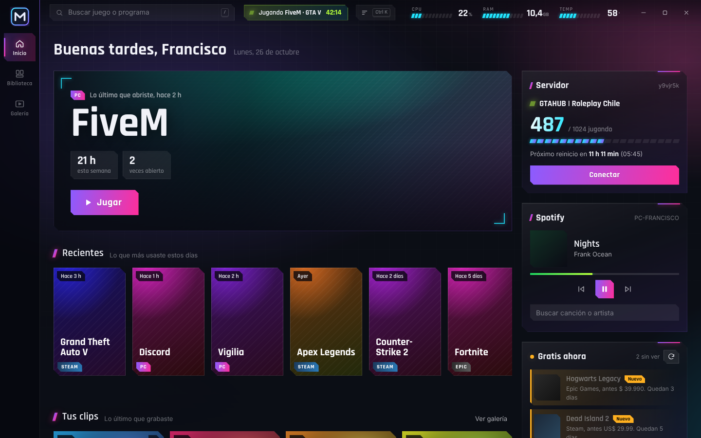
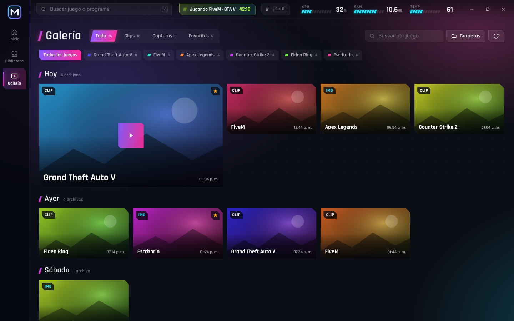
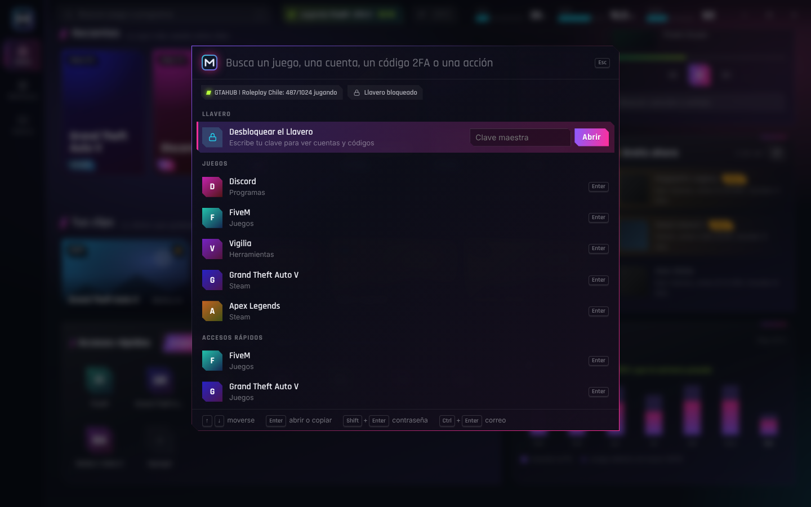

<h1 align="center">Mando</h1>

Centro de mando para tu PC con Windows: tus juegos de Steam y Epic en un solo lugar, clips y capturas, estado del servidor, modo juego automático y un llavero cifrado para tus cuentas.

  <a href="https://github.com/thefranciscovilches-tech/mando-descargas/releases/latest/download/Mando-instalador.exe"><b>⬇ Descargar Mando para Windows</b></a>

## Cómo instalarlo

1. Descarga **Mando-instalador.exe** con el enlace de arriba y ábrelo. No pide permisos de administrador.
2. Si Windows dice **"Windows protegió su PC"**: haz clic en **Más información** y luego en **Ejecutar de todas formas** (la app no tiene firma pagada de Microsoft).
3. Listo. Mando queda en el menú Inicio y **se actualiza solo** cuando hay versión nueva.

¿Prefieres no instalar nada? Descarga **Mando.exe** desde la [última versión](https://github.com/thefranciscovilches-tech/mando-descargas/releases/latest) y ábrelo directo (esa versión no se actualiza sola).

## Qué tiene

- **Biblioteca**: tus juegos de Steam y Epic aparecen solos, con carátula. Agrega programas, carpetas o páginas como accesos rápidos.
- **Galería**: clips y capturas de Xbox Game Bar, NVIDIA, AMD, OBS, Medal y Steam, con reproductor propio.
- **Paleta de mando** (Ctrl+Shift+Espacio): aparece encima del juego para abrir algo o copiar un código 2FA sin salir.
- **Servidor**: jugadores conectados, cuenta regresiva al reinicio y botón para conectar.
- **Modo juego**: al jugar baja el consumo de los programas de fondo y pausa Wallpaper Engine.
- **Llavero** (Ctrl+Shift+M): cuentas, códigos 2FA y MCs cifrados con tu clave, solo en tu PC.

Las capturas usan datos de ejemplo. Tus datos nunca salen de tu PC.
